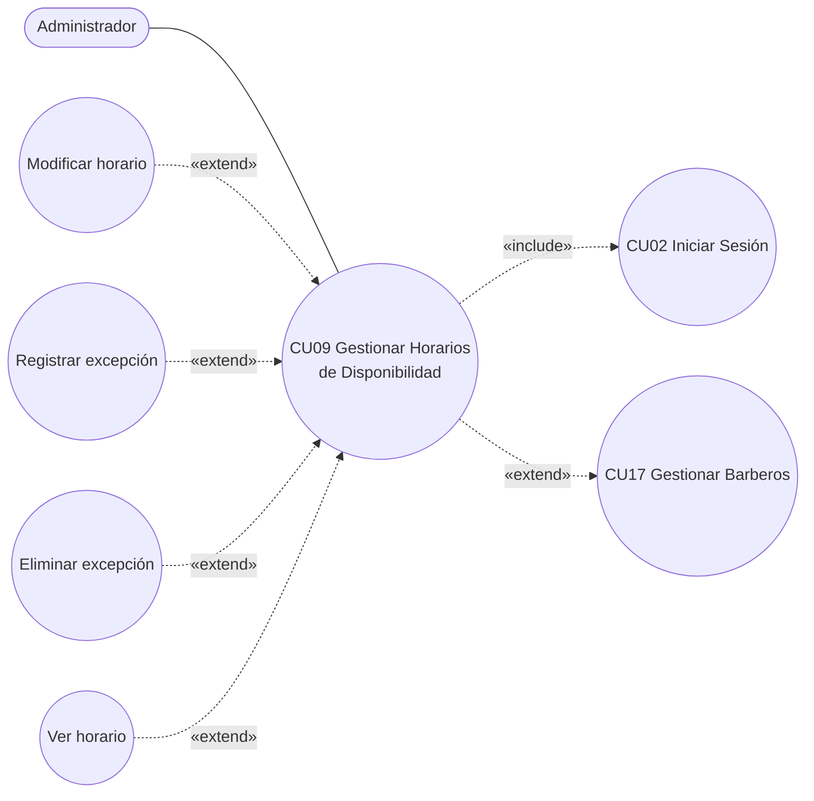

# 01 · Especificación del Caso de Uso — CU09 (versión corregida)

Contenido **[DEFINIDO]** (versión corregida, 11/10/2026). Diagrama en `diagramas/CU09-diagrama-casos-de-uso.png`.

| Campo | Contenido |
|---|---|
| **Caso de Uso** | CU09 : Gestionar Horarios de Disponibilidad |
| **Propósito** | Permitir que el Administrador defina los días y horas de trabajo de cada barbero y registre sus excepciones (vacaciones, permisos, días libres u horarios especiales), para que las citas solo se agenden cuando el barbero realmente está disponible. |
| **Descripción** | Se usa cuando un barbero recién registrado necesita su horario, cuando cambia su jornada o cuando se ausentará por un periodo. También puede iniciarse al terminar el registro de un barbero en el CU17. El Administrador marca los días que trabaja el barbero con su hora de entrada y salida, tomando como base el turno asignado en el CU17, y registra o elimina excepciones. El sistema valida que las horas estén dentro del horario de atención de la barbería y que ninguna cita pendiente o confirmada quede fuera del nuevo horario, registra cada acción en la bitácora y deja el horario disponible para la consulta de disponibilidad. |
| **Actores** | Administrador |
| **Actor Iniciador** | Administrador |
| **Precondiciones** | El Administrador debe tener una cuenta activa y haber iniciado sesión. Debe existir al menos un barbero en estado ACTIVO y el horario de atención de la barbería debe estar registrado. |

### Flujo principal (asignar horario)

1. El Administrador selecciona la opción "Horarios de Disponibilidad".
2. El sistema verifica que el Administrador tenga permiso para gestionar horarios.
3. El sistema muestra la lista de barberos activos con el estado de su horario (asignado o sin asignar), junto con las opciones asignar horario, modificar horario, ver horario, registrar excepción y eliminar excepción.
4. El Administrador selecciona un barbero sin horario y presiona "Asignar horario".
5. El sistema muestra el formulario de horario semanal con los siete días. Cada día tiene la casilla "Trabaja", la hora de entrada, la hora de salida y el selector de turno (Mañana, Tarde, Completo); al elegir un turno, el sistema completa las horas del día con las del turno. El formulario aparece precargado con el turno base asignado al barbero en el CU17.
6. El Administrador marca los días de trabajo, ajusta las horas o elige un turno para cada día y presiona "Guardar".
7. El sistema valida que haya al menos un día marcado, que cada día marcado tenga la hora de entrada menor que la de salida y dentro del horario de atención de la barbería (lunes a sábado de 09:00 a 21:00 y domingo de 09:00 a 15:00), y que ninguna cita pendiente o confirmada del barbero quede fuera del nuevo horario.
8. El sistema guarda el horario semanal del barbero, registra la acción en la bitácora y muestra el mensaje **"Horario registrado correctamente"** junto con el calendario semanal actualizado.
9. El sistema actualiza la lista mostrando al barbero con horario asignado.

### Flujos alternativos y excepciones

| Paso | Flujo |
|---|---|
| **1a** | Iniciado desde "Asignar horario ahora" del CU17: selecciona al barbero recién registrado y continúa en el paso 5. |
| **2a** | Sin permiso: **"No tiene permiso para gestionar horarios"** y finaliza. |
| **4a — Modificar horario** | Barbero con horario asignado: formulario con datos actuales; continúa en el paso 6; al guardar: **"Horario actualizado correctamente"**. |
| **4b — Registrar excepción** | Formulario con fecha de inicio, fecha de fin, tipo (vacaciones, permiso, día libre u horario especial) y motivo; si es horario especial, también hora de entrada y de salida. Al guardar: valida, registra excepción y bitácora, **"Excepción registrada correctamente"**, regresa al paso 3. |
| **4c** | En 4b, fecha fin anterior a inicio o fecha de inicio ya pasada: **"Las fechas de la excepción no son válidas"**; regresa al formulario de 4b. |
| **4d** | En 4b, se cruza con otra excepción del mismo barbero: **"Ya existe una excepción registrada en esas fechas"**; regresa al formulario de 4b. |
| **4e** | En 4b, horario especial sin horas, entrada ≥ salida o fuera del horario de atención: **"Horario inválido: revise las horas de la excepción"**; regresa al formulario de 4b. |
| **4f** | En 4b, citas pendientes o confirmadas en las fechas de la excepción (o fuera del horario especial): muestra la lista de citas afectadas con **"Existen citas en las fechas de la excepción; reprográmelas antes de guardar"**; regresa al formulario de 4b. |
| **4g — Ver horario** | Calendario semanal del barbero con excepciones vigentes y futuras; regresa al paso 3. |
| **4h — Eliminar excepción** | Sobre una excepción vigente o futura: confirmación; elimina, registra bitácora, **"Excepción eliminada correctamente"**, regresa al paso 3. Las excepciones ya terminadas no se pueden eliminar. |
| **6a** | Cancelar: descarta los cambios y regresa al paso 3. (Solo frontend.) |
| **7a** | Ningún día marcado: **"Debe marcar al menos un día de trabajo"**; regresa al paso 6. |
| **7b** | Día marcado sin horas, entrada ≥ salida o fuera del horario de atención: **"Horario inválido: revise las horas del día [día]"**; regresa al paso 6. |
| **7c** | Citas pendientes o confirmadas fuera del nuevo horario: muestra la lista de citas afectadas con **"Existen citas fuera del nuevo horario; reprográmelas antes de guardar"**; regresa al paso 6. |
| **8a** | Error al guardar: **"No fue posible guardar el horario"**; conserva el horario anterior; permite reintentar. |

### Postcondiciones

- El horario semanal del barbero queda registrado o modificado, y sus excepciones quedan registradas o eliminadas según la acción realizada.
- La disponibilidad del barbero queda actualizada de inmediato: solo se le pueden agendar citas dentro de su horario semanal, dentro del horario de atención de la barbería y fuera de sus excepciones.
- La acción quedó registrada en la bitácora.

### Requisito funcional asociado

> **RF9. Gestión de horarios y disponibilidad:** El sistema debe permitir al administrador registrar los horarios de trabajo de cada barbero y consultar su disponibilidad, evitando la asignación de reservas en horarios ya ocupados o fuera de turno.

### Operaciones para backend

| Operación | Pasos |
|---|---|
| Listar barberos activos con estado de horario | 3 |
| Obtener horario de un barbero (o sugerido desde su turno base) | 5, 4a, 4g |
| Asignar / modificar horario semanal | 4–9, 4a, 7a–7c, 8a |
| Registrar excepción | 4b–4f |
| Eliminar excepción | 4h |
| Datos de apoyo del formulario: turnos y horario de atención | 5 |

## Diagramas de secuencia y actividad

No se incluyen en esta iteración. No generarlos.
