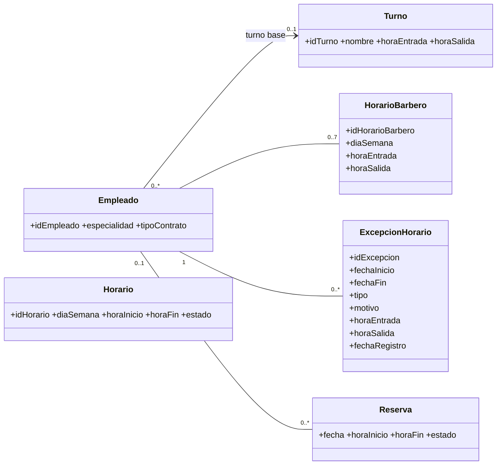

# 03 · Modelo de Datos — CU09

Las tablas `empleado` y `turno` están en `../CU01-CU02/03-modelo-de-datos.md` y `../CU17/03-modelo-de-datos.md`.

## 1. ¿El diagrama de clases actual alcanza para CU09?

**No.** La clase `HORARIO` (idHorario, diaSemana, horaInicio, horaFin, estado) no está asociada a `EMPLEADO`: según el script son las *franjas horarias de atención por día de la semana* del local, y solo se relacionan con `SERVICIO` mediante `SERVICIO_HORARIO`. No hay dónde guardar el horario de cada barbero ni sus excepciones.

| Cambio | Por qué |
|---|---|
| **Nueva clase HORARIO_BARBERO** (`idHorarioBarbero`, `diaSemana`, `horaEntrada`, `horaSalida`), asociada a EMPLEADO `1` — `0..7`. | Horario semanal de cada barbero (pasos 4–9). Un registro por día que trabaja; un día sin registro = no trabaja. |
| **Nueva clase EXCEPCION_HORARIO** (`idExcepcion`, `fechaInicio`, `fechaFin`, `tipo`, `motivo`, `horaEntrada`, `horaSalida`, `fechaRegistro`), asociada a EMPLEADO `1` — `0..*`. | Flujos 4b–4h. |
| **HORARIO** se mantiene sin cambios. | Se usa como horario de atención de la barbería para validar (paso 7, 7b, 4e). |

## 2. Diagrama de clases (subconjunto)



`Horario` no se asocia a nada nuevo: se consulta por `diaSemana` para obtener la ventana de atención del local.

## 3. Migración — [PROPUESTO]

```sql
-- Horario semanal por barbero
CREATE TABLE horario_barbero (
    id_horario_barbero  SERIAL       PRIMARY KEY,
    empleado_id         INTEGER      NOT NULL REFERENCES empleado(id_empleado) ON DELETE CASCADE,
    dia_semana          VARCHAR(10)  NOT NULL
                        CHECK (dia_semana IN ('LUNES','MARTES','MIERCOLES','JUEVES',
                                              'VIERNES','SABADO','DOMINGO')),
    hora_entrada        TIME         NOT NULL,
    hora_salida         TIME         NOT NULL,
    CONSTRAINT chk_horario_barbero_horas CHECK (hora_salida > hora_entrada),
    CONSTRAINT uq_horario_barbero_dia UNIQUE (empleado_id, dia_semana)
);

-- Excepciones: vacaciones, permisos, días libres, horarios especiales
CREATE TABLE excepcion_horario (
    id_excepcion        SERIAL       PRIMARY KEY,
    empleado_id         INTEGER      NOT NULL REFERENCES empleado(id_empleado) ON DELETE CASCADE,
    fecha_inicio        DATE         NOT NULL,
    fecha_fin           DATE         NOT NULL,
    tipo                VARCHAR(20)  NOT NULL
                        CHECK (tipo IN ('VACACIONES','PERMISO','DIA_LIBRE','HORARIO_ESPECIAL')),
    motivo              VARCHAR(200),
    hora_entrada        TIME,
    hora_salida         TIME,
    fecha_registro      TIMESTAMP    NOT NULL DEFAULT NOW(),
    CONSTRAINT chk_excepcion_fechas CHECK (fecha_fin >= fecha_inicio),
    CONSTRAINT chk_excepcion_horas CHECK (
        (tipo = 'HORARIO_ESPECIAL' AND hora_entrada IS NOT NULL
                                   AND hora_salida  IS NOT NULL
                                   AND hora_salida > hora_entrada)
     OR (tipo <> 'HORARIO_ESPECIAL' AND hora_entrada IS NULL AND hora_salida IS NULL)
    )
);

CREATE INDEX idx_excepcion_empleado_fechas ON excepcion_horario (empleado_id, fecha_inicio, fecha_fin);
CREATE INDEX idx_reserva_empleado_fecha    ON reserva (empleado_id, fecha);
```

Notas:

- El cruce entre excepciones (4d) se valida en la aplicación. No usar `EXCLUDE ... USING gist` para no exigir la extensión `btree_gist`.
- `dia_semana` usa los mismos valores que la tabla `horario` (sin tildes: `MIERCOLES`, `SABADO`), para poder compararlos directamente.
- `ON DELETE CASCADE` sigue el estilo de `empleado_servicio`. En la práctica los empleados nunca se borran (CU01).

## 4. Semilla — [PROPUESTO]

Para que los barberos de la semilla no queden sin horario, cargar el horario semanal desde su turno base: lunes a sábado con las horas de `turno`, domingo sin trabajar (día de descanso según la Entrevista #1, pregunta 4.3).

```sql
INSERT INTO horario_barbero (empleado_id, dia_semana, hora_entrada, hora_salida)
SELECT e.id_empleado, d.dia, t.hora_entrada, t.hora_salida
FROM empleado e
JOIN turno t        ON t.id_turno = e.turno_id
JOIN usuario u      ON u.id_usuario = e.usuario_id
JOIN rol_usuario ru ON ru.usuario_id = u.id_usuario
JOIN rol r          ON r.id_rol = ru.rol_id AND r.nombre = 'Barbero'
CROSS JOIN (VALUES ('LUNES'),('MARTES'),('MIERCOLES'),('JUEVES'),('VIERNES'),('SABADO')) AS d(dia)
ON CONFLICT (empleado_id, dia_semana) DO NOTHING;
```

Sin excepciones en la semilla.

## 5. Horario de atención (tabla `horario`) — [DEFINIDO] los datos, [PROPUESTO] la lectura

La ventana de atención de un día es: `MIN(hora_inicio)` a `MAX(hora_fin)` de las filas de `horario` con ese `dia_semana` y `estado = 'ACTIVO'`.

Con la semilla actual: lunes a sábado 09:00–21:00 y domingo 09:00–15:00, que coincide con el paso 7 del CU. Si un día no tiene filas activas, la barbería está cerrada ese día y no se puede marcar como día de trabajo (7b).

Las franjas de la semilla son contiguas, por eso basta con el mínimo y el máximo. No usar las franjas individuales para validar.

## 6. JPA — [PROPUESTO]

- Entidades `HorarioBarbero` y `ExcepcionHorario` en `modulo_servicios_reservas`, cada una con `@ManyToOne(fetch = LAZY) Empleado`.
- `diaSemana` como `enum DiaSemana { LUNES, MARTES, MIERCOLES, JUEVES, VIERNES, SABADO, DOMINGO }` con `@Enumerated(STRING)`. Agregar un método `DiaSemana.de(java.time.DayOfWeek)` para convertir desde fechas.
- `tipo` como `enum TipoExcepcion { VACACIONES, PERMISO, DIA_LIBRE, HORARIO_ESPECIAL }`.
- Horas como `LocalTime`, fechas como `LocalDate`.
- Para leer `horario` y `reserva`, si sus entidades aún no existen en el proyecto, usar consultas nativas en un repositorio de este módulo. No crear entidades completas de `Reserva` en este CU.
