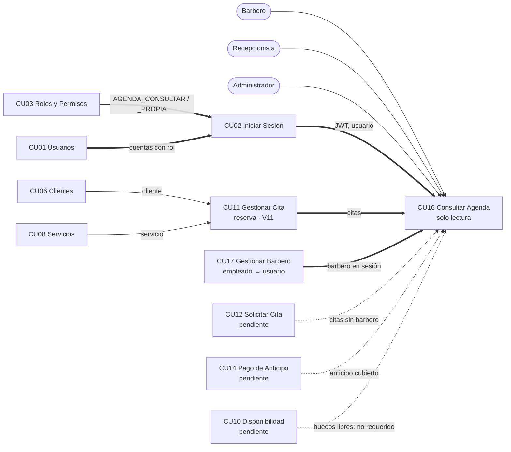
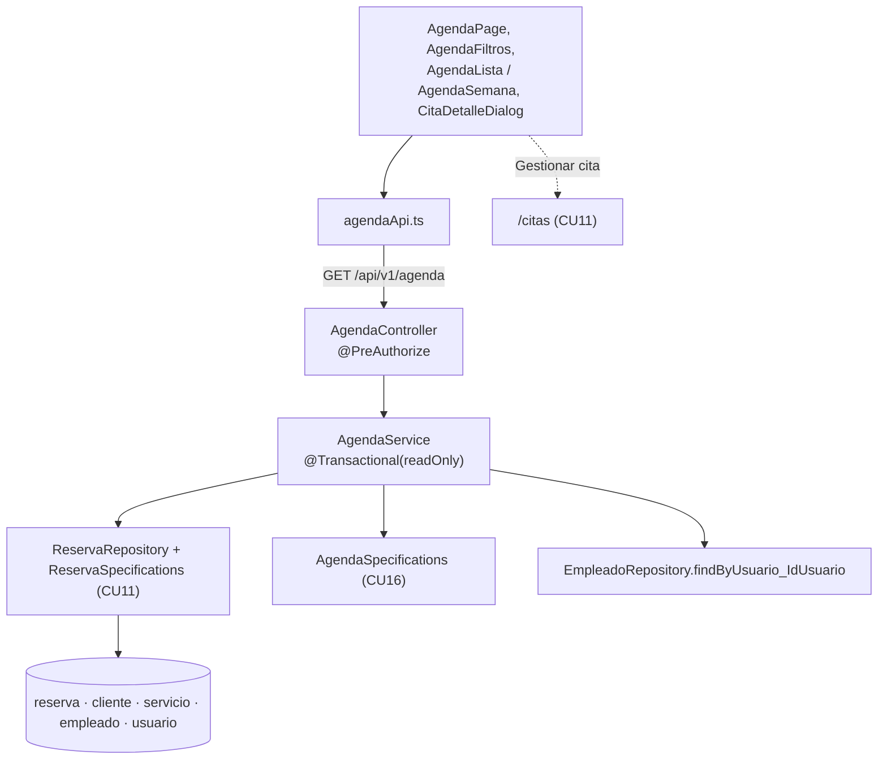

# CU16 – Dependencias y trazabilidad

CU16 no crea datos: muestra las citas que otros casos de uso registran. Esta sección identifica de qué depende, verificado en el código (rama `dev-lucas`, 14/10/2026). La sección de CU16 en `../Ciclo#2.md` no tiene apartado "Dependencias y conexiones"; este documento lo cubre.

## 1. Matriz de dependencias

| Caso de uso / módulo | Qué aporta | Qué usa CU16 | Entidades, tablas y código | Tipo | Estado | Si no existiera |
|---|---|---|---|---|---|---|
| CU11 Gestionar Cita | Crea, reprograma, confirma, atiende y cancela citas | Las citas que se muestran | Tabla `reserva` (`V11__cu11_reserva.sql`), `entity/Reserva`, `ReservaRepository.findAll(Specification, Pageable)`, `findWithDetalleByIdReserva`, `barberosActivos`, `ReservaSpecifications` | Obligatoria | Implementado (rama `dev-jhancarla`, integrada en `dev-lucas`) | No habría tabla ni datos |
| CU17 Gestionar Barbero | Empleados vinculados 1:1 a su usuario, con rol Barbero | Identificar al barbero de la sesión y nombrarlo | `seguridad_usuarios/entity/Empleado`, `EmpleadoRepository.findByUsuario_IdUsuario` | Obligatoria | Implementado (`main`) | No se podría restringir al barbero a sus citas |
| CU02 Iniciar Sesión | JWT y usuario autenticado | `idUsuario` y permisos del actor | `JwtAuthenticationFilter`, `UsuarioAutenticado`, `PermisosService` | Obligatoria | Implementado (`main`) | Toda consulta respondería 401 |
| CU01 Gestionar Usuarios | Cuentas con rol | Cuentas de Recepcionista y Administrador | Tablas `usuario`, `rol_usuario` | Obligatoria (precondición) | Implementado (`main`) | Nadie podría consultar |
| CU03 Roles y Permisos | Qué rol tiene qué permiso; permisos activos | `AGENDA_CONSULTAR`, `AGENDA_CONSULTAR_PROPIA` | Semilla `V2`, `UsuarioRepository.permisosEfectivos` (solo roles y permisos activos) | Obligatoria | Implementado (`main`) | Todos recibirían 403 |
| CU06 Gestionar Clientes | Clientes con teléfono | Nombre y teléfono | Tabla `cliente` (`V1`, `V4`) vía `Reserva.cliente` | Indirecta (a través de CU11) | Implementado (`main`) | No habría a quién agendar |
| CU08 Catálogo de Servicios | Servicios y precios | Nombre y precio | Tabla `servicio` (`V3`) vía `Reserva.servicio` | Indirecta (a través de CU11) | Implementado (`main`) | No habría servicios que agendar |
| CU14 Registrar Pago de Anticipo | Pago del 20 % | "Si el anticipo ya fue cubierto" | Hoy solo existe `reserva.monto_anticipo`; no hay columnas ni tablas de pago del anticipo | Opcional para funcionar; necesaria para ese dato | Pendiente (sin código en ninguna rama) | Se muestra el monto y "Estado del pago no disponible" |
| CU12 Solicitar Cita | Citas web, posiblemente sin barbero | Citas `canal = WEB`, `empleado_id` nulo | Misma tabla `reserva` | Opcional (fuente futura) | Pendiente | Ninguno: CU16 ya muestra "Sin asignar" |
| CU09 Horarios / CU10 Disponibilidad | Horarios y huecos libres | Nada: la especificación de CU16 solo lee `reserva`, `cliente`, `servicio` y `empleado` | `horario`, `horario_barbero` (V12, solo en `dev-prueba`) | No requerida | CU09 en `dev-prueba`; CU10 pendiente | Ninguno. La vista semanal consulta 7 días de `reserva` |
| CU05 Bitácora | Auditoría | Nada | — | No aplica (solo lectura) | Implementado | Ninguno |

## 2. Diagrama

Flechas gruesas: dependencias obligatorias. Flechas punteadas: opcionales o futuras.

## 3. Trazabilidad requisito → código → prueba

| Requisito | Código | Prueba (`AgendaControllerIT`) |
|---|---|---|
| Barbero solo ve sus citas, aunque manipule la petición | `AgendaService.listar`, `detalle`, `idEmpleadoPropio` | 3, 8, 9, 11 |
| Recepcionista y Administrador ven todo y filtran por barbero | `AgendaService.listar` (`puedeVerTodas`), `GET /agenda/barberos` | 4 |
| Sin permiso: 403; sin sesión: 401 | `@PreAuthorize` en `AgendaController` | 5 |
| Citas de CU11 visibles y actualizadas (alta, reprogramación, confirmación, cancelación) | Lectura directa de `reserva` en cada consulta | 1, 2, 10 |
| Vista semanal (lunes a domingo) y diaria | `AgendaService.listar` (`vista`) | 10, 11 |
| Fecha, estado y vista inválidos; ausencia de resultados | `parsearFecha`, `normalizarEstado`, `normalizarVista` | 7, 10 |
| Solo lectura | Sin endpoints de escritura; transacciones de solo lectura | 6 |
| Detalle e historial del cliente | `AgendaService.detalle`, `AgendaSpecifications` | 4, 8 |
| Cita sin barbero y estado NO_ASISTIO | `ORDEN_AGENDA`, `AgendaMapper` | 9, 11 |
| Teléfono, colores, anticipo pendiente, botones 8a/8b, mensajes 2a/3a/5a, diseño adaptable | `CitaTarjeta`, `CitaDetalleDialog`, `AgendaPage`, `AgendaFiltros`, `GRILLA_TARJETAS` | Verificación en navegador (`02-evidencias-de-prueba.md` §3) |

## 4. Inconsistencias encontradas en la documentación (no corregidas aquí)

1. `../Ciclo#2.md` llama "CU16 (Barberos)" a la gestión de barberos en CU10 (dependencias) y CU11 (dependencias), mientras que la sección CU16 es esta agenda y `Ciclo #1` define Gestionar Barbero como CU17.
2. La descripción de CU16 dice "agenda diaria y semanal", pero el flujo mínimo no detalla la semanal y el modo semanal figura entre las funcionalidades extras. Se implementaron ambas.
3. CU14 menciona `fecha_pago_anticipo`, `metodo_pago_id` y `caja_id` para la reserva, columnas que no existen en `Base de Datos/Script.sql` §22; el diagrama de clases sí relaciona `RESERVA` con `METODO_PAGO`.
4. Ningún documento del repositorio indica el requisito funcional (RF) del que nace CU16.
